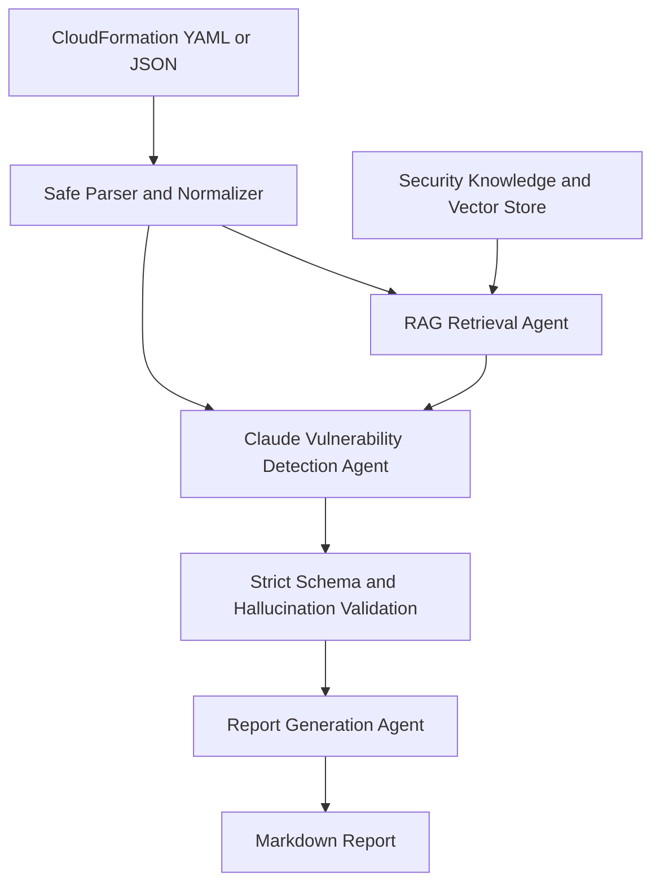

# IaC Security Agent

Phase 2 implementation of the workflow described in "LLM Agentic Workflow for
Automated Vulnerability Detection and Remediation in Infrastructure-as-Code".
It parses AWS CloudFormation, retrieves grounded security guidance, asks Claude
Sonnet 3.5 V2 to produce validated findings, and writes a deterministic Markdown
report. It never executes, deploys, or automatically modifies a template.

## Architecture



The three logical agents are preserved:

1. The retrieval agent builds resource-aware queries and supplies chunks with stable source identifiers.
2. The vulnerability detection agent receives raw and normalized templates, resource summaries, relationships, and retrieved guidance. It uses Claude for contextual reasoning rather than a hardcoded vulnerability ruleset.
3. The deterministic report agent formats only validated findings and cannot introduce new findings.

## Setup

Python 3.10 or newer is required.

```powershell
python -m venv .venv
.venv\Scripts\Activate.ps1
python -m pip install -r requirements.txt
```

AWS credentials use boto3's standard provider chain. Do not put credentials in
the repository or `.env` file.

## Configuration

- `AWS_REGION` (default `us-east-1`)
- `BEDROCK_LLM_MODEL_ID` (default Claude Sonnet 3.5 V2 model ID)
- `BEDROCK_EMBEDDING_MODEL_ID` (default Titan Text Embeddings V2)
- `LLM_TEMPERATURE` (default `0.0`)
- `LLM_MAX_TOKENS` (default `4096`)
- `LLM_MAX_RETRIES` (default `2`)
- `TOP_K_RETRIEVAL` (default `5`)
- `LOCAL_VECTOR_STORE_PATH` (default `reports/vector_store.json`)
- `MAX_TEMPLATE_BYTES` (default 1 MiB)
- `REPORTS_PATH` (default `reports`)

Keep the exact Claude model or inference-profile ID configurable because
availability and identifiers vary by AWS region and account.

## Commands

First index the security guidance. Local embeddings are useful for development;
omit the flag to use Titan through Bedrock.

```powershell
python -m src.cli ingest --path knowledge_base --local-embeddings
```

Run the complete analysis. `--local-embeddings` avoids Titan calls but Claude
still uses Bedrock Runtime.

```powershell
python -m src.cli analyze examples/vulnerable/open_ssh.yaml --local-embeddings
python -m src.cli analyze examples/vulnerable/rds_unencrypted.json --output reports/rds-report.md --top-k 5 --verbose
```

Phase 1 commands remain available:

```powershell
python -m src.cli parse examples/vulnerable/open_ssh.yaml
python -m src.cli retrieve examples/vulnerable/open_ssh.yaml --local-embeddings
```

Reports contain severity totals, evidence, impact, retained RAG citations,
actionable remediation, optional CloudFormation snippets, confidence,
resources, timing/model metadata, and uncertainty limitations.

## Prompt and Validation Controls

The detection prompt separates `<TEMPLATE>`, `<NORMALIZED_CONTEXT>`,
`<RESOURCE_CONTEXT>`, `<SECURITY_GUIDANCE>`, and `<INSTRUCTIONS>`. Template and
knowledge content are explicitly marked as untrusted data. The model must emit
one JSON object matching the exact schema.

Model output is rejected when fields are missing or added, severities or
confidence are invalid, resources/types do not exist in the parsed template,
related resources are invented, or citations were not retrieved. Malformed
output is retried once. Every accepted finding includes template evidence and
security reasoning. Low-confidence concerns are retained as uncertain in the
report. CloudFormation conditions are represented but not claimed to be fully
evaluated.

Input size is bounded, YAML uses a safe loader, template content is never
executed, full templates are not logged, and report paths are constrained to
the configured reports directory. Suggested fixes are report content only and
are never deployed.

## AWS Requirements

Direct runtime mode requires access to the configured models and, at minimum,
`bedrock:InvokeModel` on the configured Claude model/inference profile and Titan
embedding model. The selected models must be enabled in the configured region.
The CLI uses no static credentials.

For Bedrock Agents deployment, keep the logical retrieval, detection, and
report instructions as separate agent/action boundaries and expose the current
Python interfaces through action groups or orchestration code. Supply the same
knowledge/vector dependency and schema validation after agent output. This
repository provides the direct Bedrock Runtime adapter for local execution; it
does not claim to provision a Bedrock Agent, knowledge base, IAM role, or model
access.

## Testing

```powershell
python -m pytest
```

Tests mock all Claude responses and incur no AWS cost. They cover the Bedrock
request shape, prompt isolation, strict output parsing, unknown-resource and
citation rejection, retries, empty and multiple findings, citation retention,
cross-resource context, deterministic reporting, orchestration, CLI analysis,
and all five vulnerable/secure example scenarios.

## Current Limitations

- The included vector store is local JSON; the abstraction remains ready for a managed OpenSearch implementation.
- Security conclusions depend on the quality and coverage of ingested guidance.
- Static analysis cannot resolve runtime state, every condition, transforms, macros, external stacks, or deployed resource policies.
- Remediation snippets are model suggestions that require review and validation.
- Phase 3 still owns evaluation datasets, experimental reproduction, CI/CD, performance measurement, cloud deployment configuration, and final validation.
