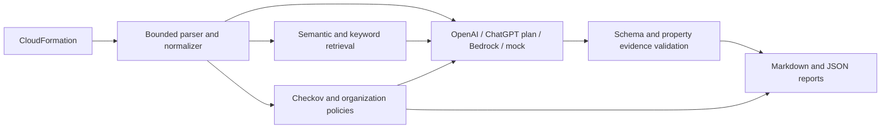

# SecureIaC

Local, report-only AWS CloudFormation security analysis for a research
project. SecureIaC combines optional Checkov scanning, deterministic organization
policies, retrieval, and provider-independent contextual detection. It writes
Markdown and JSON reports; it never deploys infrastructure or overwrites input
templates. Terraform is **not supported**.

The three logical agents remain retrieval, contextual detection, and deterministic
reporting. Scanners, policy evaluation, evidence validation and candidate checks
are ordinary modules, not additional agents.



## Windows PowerShell setup

Python 3.10+ is required. Run from the repository root. These commands install
dependencies; they do not make inference calls.

```powershell
python -m venv .venv
.\.venv\Scripts\Activate.ps1
python -m pip install -e ".[dev]"
python -m pytest -q

# Credential-free demonstration; no embedding download needed
python -m src.cli analyze examples/vulnerable/open_ssh.yaml --provider mock --no-rag

# Deterministic organization-policy analysis, without cloud credentials
python -m src.cli analyze examples/vulnerable/rds_unencrypted.json --deterministic-only --policy policies/example.yaml --environment production --region ap-south-1

# Optional scanner and linter installation
python -m pip install -e ".[scanners]"
python -m src.cli analyze examples/vulnerable/open_ssh.yaml --deterministic-only --scan --policy policies/example.yaml
```

Missing or failed scanners are reported as unavailable/failed, not as clean.
`complete` describes completion of the **requested scope**, not proof of security.
Reports distinguish demo, deterministic-only and live results. Requested scanner
failure makes a run partial; rejected LLM output makes it failed and the CLI exits 1.
Findings themselves do not currently cause a nonzero exit code.

## Local semantic retrieval

The default embedding backend is Sentence Transformers, independent of the LLM.
Install and download the model explicitly once; analysis loads only cached model
files, with remote code disabled. This requires disk space and an initial network
download, but no API credentials or paid inference.

```powershell
python -m pip install -e ".[semantic]"
python -c "from sentence_transformers import SentenceTransformer; SentenceTransformer('sentence-transformers/all-MiniLM-L6-v2', trust_remote_code=False)"
$env:EMBEDDING_BACKEND = "semantic"
python -m src.cli ingest --path knowledge_base --local-embeddings
python -m src.cli retrieve examples/vulnerable/open_ssh.yaml --local-embeddings
python -m src.cli analyze examples/vulnerable/open_ssh.yaml --provider mock --local-embeddings
```

For offline tests or a lightweight demonstration, use `$env:EMBEDDING_BACKEND =
"hash"` before ingest/retrieve. Hash embeddings are **not semantic embeddings**.
Changing models or dimensions requires reingestion. Ingestion replaces the index
and records the model, dimensions, chunking settings and corpus hash. Retrieval
filters explicitly typed guidance by resource type, retains generic guidance,
and ranks by `0.7 * cosine similarity + 0.3 * query-token overlap`, breaking ties
by stable chunk ID. This ranking has not been experimentally optimized.

## OpenAI API-key access

The ordinary API uses separate API billing. ChatGPT Pro is not an entitlement to
unlimited application inference or ordinary API credits. The adapter uses the
official Python SDK, Responses API and strict JSON Schema output, followed by
application validation. It sends `store=false` and no temperature or reasoning
settings. Select a model that supports Responses structured outputs.

```powershell
$env:LLM_PROVIDER = "openai"
$env:AUTH_MODE = "api_key"
$env:OPENAI_MODEL = "gpt-4o-mini-2024-07-18"
# Supply OPENAI_API_KEY through your environment/secret manager, not source files.
$env:ENABLE_LIVE_CALLS = "true"
python -m src.cli analyze examples/vulnerable/open_ssh.yaml --local-embeddings --scan --policy policies/example.yaml
```

The last command makes a paid API call when configured. No live inference was
performed during implementation. A key's existence does not enable live calls:
`ENABLE_LIVE_CALLS=true` is required. There is no automatic provider or billing
fallback. Exact returned model, request identifier, usage and timings are recorded
when supplied; pricing/cost estimates and response caching are not implemented.

## Sign in with ChatGPT (local, experimental)

Official documentation describes ChatGPT-plan usage for open-source, locally
hosted apps. SecureIaC implements this as a separate local OAuth mode. Account
eligibility, granted permissions, account-specific models and usage limits still
apply. This flow has **not been verified with a real account**. The repository's
open-source licensing/release eligibility must be settled before distributing it
as an eligible OSS integration; no license was invented on the owner's behalf.

```powershell
python -m pip install -e ".[chatgpt]"
python -m src.cli auth login
python -m src.cli auth status
python -m src.cli auth models
# Select a slug returned by the signed-in account's model catalog:
$env:OPENAI_MODEL = "<account-model-slug>"
$env:LLM_PROVIDER = "chatgpt"
$env:AUTH_MODE = "chatgpt"
$env:ENABLE_LIVE_CALLS = "true"
python -m src.cli analyze examples/vulnerable/open_ssh.yaml --no-rag
python -m src.cli auth logout
```

`auth login --account <issued-client-id>` reauthorizes an existing registration;
`auth select --account <issued-client-id>` switches accounts. Credentials are
stored only in SecureIaC's OS credential-vault entries. Plaintext keyring backends
are refused. Login uses loopback callback, PKCE, state, nonce, JWKS signature and
identity checks; refreshes are serialized, and logout attempts remote revocation.
No other application's credentials or browser sessions are read.

Subscription inference discovers models per account, streams with `store=false`,
and requires a completed response before validating findings. Unsupported preview
parameters such as `max_output_tokens` are omitted. A local output-byte limit can
stop consumption but cannot guarantee a server-side usage cap. Expired sessions,
refusals, interrupted streams and quota errors never trigger API-key fallback.
Do not use a personal subscription as a shared account for public users.

Official references checked during implementation:

- [Plan usage overview](https://developers.openai.com/siwc/token-sharing-open-source)
- [Registration and sign-in](https://developers.openai.com/siwc/token-sharing-open-source/sign-in)
- [Accounts and sessions](https://developers.openai.com/siwc/token-sharing-open-source/profiles-and-sessions)
- [Models and inference](https://developers.openai.com/siwc/token-sharing-open-source/models-and-inference)
- [Preview restrictions](https://developers.openai.com/siwc/token-sharing-open-source/preview-limitations)
- [Structured outputs](https://developers.openai.com/api/docs/guides/structured-outputs)

## Configuration and commands

[.env.example](.env.example) lists settings. The app reads **process environment
variables**, not `.env` automatically; the existing `.env` is untouched. Default
provider is `mock`, live calls are disabled, semantic embeddings are local.
AWS packages are optional (`pip install -e ".[aws]"`). Explicit `bedrock` selection
uses the AWS credential chain; Titan requires `EMBEDDING_BACKEND=titan` and live
enablement. Retained Bedrock metadata is less detailed than OpenAI metadata.

`ingest`, `parse`, `retrieve`, `analyze` remain supported. Analysis options include
`--provider`, `--no-rag`, `--scan`, `--policy`, `--environment`, `--region`,
`--deterministic-only`, `--no-relationships`, `--top-k`, `--output`, `--verbose`.
Environment selection comes from the operator, never template metadata.

The version-1 YAML [example policies](policies/example.yaml) illustrate tags,
regions, encryption, administrative CIDRs, public access and logging. Adapt their
explicit parameters to your organization: they are examples, not universal AWS
defaults. Optional exceptions require `resource`, `reason`, and ISO `expires`.
Intrinsic values and conditional resources remain unknown. Region approval uses
explicit operator deployment context, not a guessed AWS region.

## Evidence and safety

The v2 runtime findings schema rejects missing/extra fields, unknown resources or
types, invented relationships/citations, non-finite confidence, and property values
that disagree with the original parsed template. Findings retain JSON Pointer
paths, observed JSON or missing-property evidence, assumptions and uncertainty.
No source line is invented. Verified evidence is a configuration fact; prose risk
interpretations still need review. Self-reported confidence is not calibrated.

Templates, descriptions, guidance and policy prose are untrusted data. Prompt
delimiters organize context; code validates outputs. YAML aliases, duplicate keys,
excessive nesting/node counts, oversized templates and oversized model context are
rejected. No silent context truncation is used. Reports escape untrusted HTML and
link markup. The local UI renders data, not executable model HTML. Reports and
local indexes can contain sensitive configuration; protect and delete them as needed.

## Candidate remediation

Supply an explicit JSON add/replace patch and independently allowlist its exact
resource-property paths. Candidates must be new JSON files under the report root.
Resource deletion, non-property changes, duplicate edits and input overwrite are
rejected. No automatic model-generated patch is applied.

```powershell
python -m src.cli remediate examples/vulnerable/rds_unencrypted.json --patch examples/rds-encryption-patch.json --allow-property /Resources/Database/Properties/StorageEncrypted --output reports/rds-candidate.json --policy policies/example.yaml --environment production --region ap-south-1
```

The command reparses, runs cfn-lint, scans original/candidate templates and compares
policy outcomes. It writes `.diff` and `.validation.json` siblings. Missing tools
or new failures leave the candidate marked `unvalidated_or_failed` and exit 1.
Passing checks do not prove functional equivalence or eliminate unresolved risks.

## Local UI and evaluation

```powershell
python -m pip install -e ".[ui]"
python -m streamlit run src/ui.py --server.address 127.0.0.1
python -m src.evaluation --variant scanner-only
```

The UI supports sample/upload/paste input, environment/policy selection, mode and
provider status, progress, evidence in JSON and JSON/Markdown downloads. UI upload
files and temporary reports are deleted after each run; results remain in the
browser session until cleared. Do not expose this UI as a public service.

See [architecture](docs/ARCHITECTURE.md), [evaluation](docs/EVALUATION.md),
[hosting and privacy](docs/HOSTING.md), and [implementation record](docs/IMPLEMENTATION.md).
The verified core dependency snapshot is [requirements-tested.txt](requirements-tested.txt).
Starter labels are generated and pending human review; no accuracy or publication
claims are made. Evaluation keeps failures visible and related variants together.

## Remaining limitations

- CloudFormation static analysis cannot establish deployed exposure or evaluate all intrinsics, macros, transforms and runtime state.
- The optional OAuth integration, real semantic model, installed scanners and browser UI need environment-specific integration verification; mocked tests are not live validation.
- Evidence checks validate referenced values, not the truth of every sentence in an LLM explanation.
- Evaluation labels need independent review and complete rule mappings before precision/recall is meaningful. Evidence correctness and remediation validity need human adjudication.
- Local scanner process limits are not a security sandbox; use isolated workers before handling untrusted public uploads.
- No managed vector database, Terraform support, caching, automatic deployment, public hosting, or guaranteed paper acceptance is provided.
